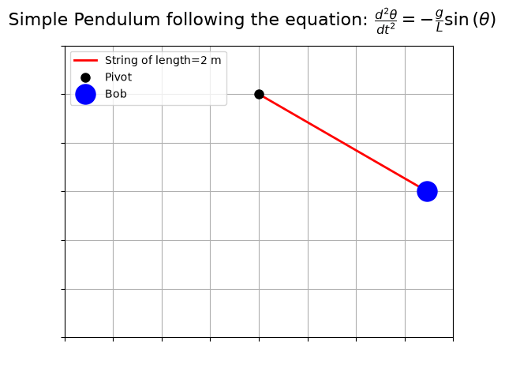
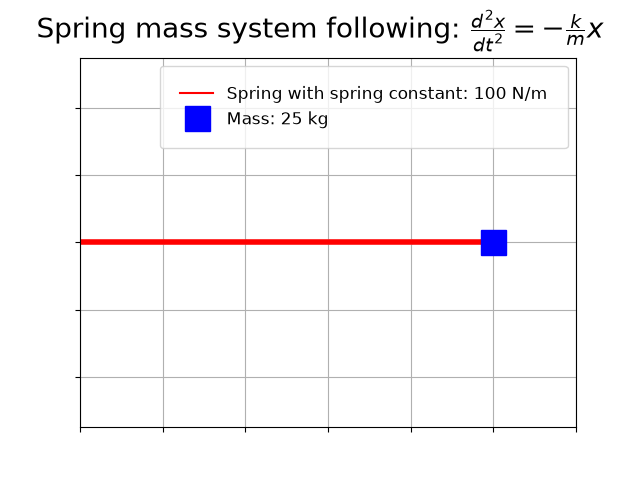
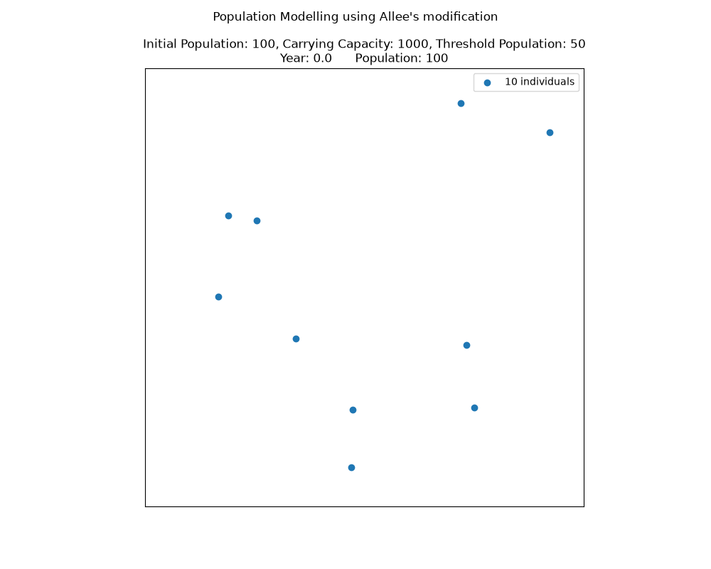
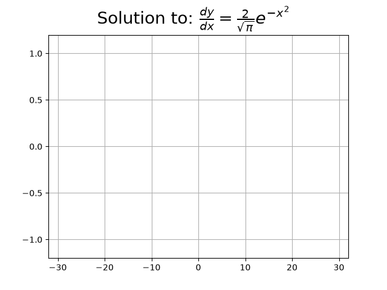

# Animation examples

The scripts in this directory use the project's solvers to calculate trajectories, then display them with Matplotlib's `FuncAnimation`. The Python demos use the [`solver.ivp`](../solver/README.md) methods. Pre-rendered GIF and MP4 files are stored in [`animations/`](animations/).

## Gallery

<table>
  <tr>
    <td align="center">
      <strong>Simple pendulum</strong><br>
      
    </td>
    <td align="center">
      <strong>Spring–mass system</strong><br>
      
    </td>
  </tr>
  <tr>
    <td align="center">
      <strong>Population model</strong><br>
      
    </td>
    <td align="center">
      <strong>Error function</strong><br>
      
    </td>
  </tr>
  <tr>
    <td align="center">
      <strong>Damped spring–mass system</strong><br>
      <a href="https://github.com/user-attachments/assets/f43c315b-6fb7-4008-82ab-dff599e1c48f">Watch the damped spring–mass animation</a>
    </td>
    <td align="center">
      <strong>Double pendulum</strong><br>
      <a href="https://github.com/user-attachments/assets/e3828ccc-f8d4-4178-8b3e-86f478523abf">Watch the double-pendulum animation</a>
    </td>
  </tr>
  <tr>
    <td align="center">
      <strong>Lorenz attractor</strong><br>
      <a href="https://github.com/user-attachments/assets/b3f5ef3b-e850-42d4-a14c-ffcaf710aa20">Watch the Lorenz-attractor animation</a>
    </td>
    <td align="center">
      <strong>Two Lorenz trajectories</strong><br>
      <a href="https://github.com/user-attachments/assets/9ca35a00-3e58-4b64-adbf-3a05f9c08c49">Watch the two-trajectory Lorenz animation</a>
    </td>
  </tr>
  <tr>
    <td align="center">
      <strong>Halvorsen attractor</strong><br>
      <a href="https://github.com/user-attachments/assets/2b5d75e8-8198-4276-89ed-669f307e3bf9">Watch the Halvorsen attractor animation</a>
    </td>
    <td align="center">
      <strong>Stay tuned!</strong><br>
    </td>
  </tr>
</table>

The MP4 animations use direct links so they remain accessible on Markdown renderers that do not display embedded video players.

## Run a Python demo

Install the Python project using the [root setup guide](../README.md#python-setup). From the repository root, run a script such as:

```bash
uv run python animation_scripts/pysolved/simple_pendulum.py
```

Replace the script path with another Python source from the gallery. Each script computes the full numerical solution before opening an interactive Matplotlib window. A graphical Matplotlib backend is required. The scripts display the animation and do not save a new file by default.

## C++ Halvorsen attractor

The C++ example integrates the Halvorsen system and saves its time and state arrays in Jacobi's `.jcbi` format. The executable writes these files to its current working directory, while `animator.py` reads them from its current working directory. Build the `HalvorsenAttractor` target from the repository root:

```bash
cmake --build build --target HalvorsenAttractor
```

Run the executable from its Ninja build directory, then move the generated files to the example source directory. On Linux or macOS:

```bash
cd build/animation_scripts/csolved/halvorsen_attractor

./HalvorsenAttractor

cd ../../../../

mv build/animation_scripts/csolved/halvorsen_attractor/double_halvorsen_attractor_time.jcbi animation_scripts/csolved/halvorsen_attractor/

mv build/animation_scripts/csolved/halvorsen_attractor/double_halvorsen_attractor_solution.jcbi animation_scripts/csolved/halvorsen_attractor/

cd animation_scripts/csolved/halvorsen_attractor

uv run python animator.py
```

On Windows PowerShell, use:

```powershell
Set-Location build/animation_scripts/csolved/halvorsen_attractor

.\HalvorsenAttractor.exe

Set-Location ..\..\..\..

Move-Item -Force build/animation_scripts/csolved/halvorsen_attractor/double_halvorsen_attractor_time.jcbi animation_scripts/csolved/halvorsen_attractor/

Move-Item -Force build/animation_scripts/csolved/halvorsen_attractor/double_halvorsen_attractor_solution.jcbi animation_scripts/csolved/halvorsen_attractor/

Set-Location animation_scripts/csolved/halvorsen_attractor

uv run python animator.py
```

The `.jcbi` files are generated outputs and can be recreated by running the executable again.

The C++ build requires Jacobi at the paths documented in the C++ guide.

## Saving an animation

To export a modified Python animation, call `.save(...)` on its `FuncAnimation` object before `plt.show()`:

```python
anim.save("animation_scripts/animations/output.gif", writer="pillow", fps=30)
```

For MP4 output, use `writer="ffmpeg"` and ensure FFmpeg is installed. Some scripts name their animation object `ani` rather than `anim`. GIF export requires Matplotlib's Pillow writer. Exporting can take additional time and memory.

## Related guides

- [Python solver](../solver/README.md)
- [Analysis notebooks](../analysis/README.md)
- [C++ solver](../csolver/README.md)

## Project tree

```text
animation_scripts/
├── animations/                   # Pre-rendered GIF and MP4 files
├── csolved/
│   └── halvorsen_attractor/      # C++ simulation and Python animator
├── pysolved/                     # Python animation scripts
└── README.md                     # Animation guide
```

## License

The scripts and rendered files are part of the project distributed under the [MIT License](../LICENSE).
